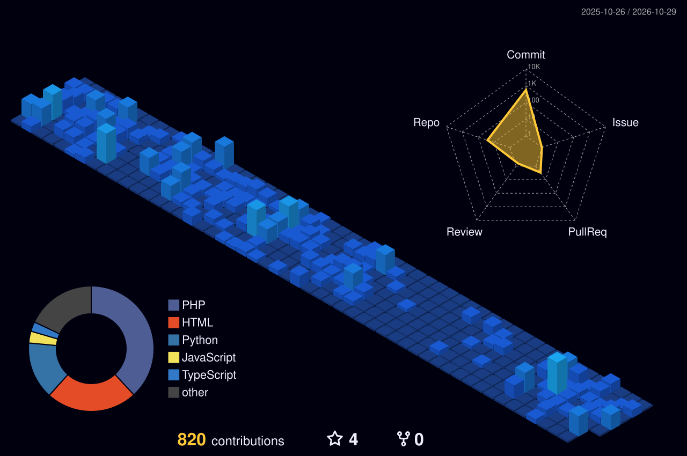

 

 

 

### 🚀 Proyectos destacados

<table>
<tr>
<td width="50%" valign="top">

#### TinoProp CRM
CRM inmobiliario **multi-tenant**: varias inmobiliarias comparten instalación viendo solo sus datos. 19 módulos, 7 roles jerárquicos, pipeline Kanban, matching demanda–oferta e i18n. **41 versiones.**

`PHP 8` `MySQL` `Chart.js` `Multi-tenant`

[**Demo**](https://tinoprop.com) · [Código](https://github.com/Valentindg2506/Tinoprop) · [Caso de estudio](https://portafolio.valentindg.com/proyectos/tinoprop-crm.html)

</td>
<td width="50%" valign="top">

#### RoomManager
Gestión de alquiler por habitaciones: contratos y recibos en PDF, liquidaciones a propietarios con **firma digital**, suscripciones con **Stripe** y API REST de 33 endpoints.

`PHP` `MySQL` `Stripe` `API REST`

[**Demo**](https://roommanager.tinoprop.com) · [Caso de estudio](https://portafolio.valentindg.com/proyectos/roommanager.html) · 🔒 código privado

</td>
</tr>
<tr>
<td width="50%" valign="top">

#### InmoCRM
CRM inmobiliario con **2FA TOTP implementado desde cero**, motor de matching entre demandas y cartera, facturación y auditoría de actividad. 14 módulos y 23 tablas.

`PHP` `MySQL` `JavaScript` `TOTP`

[Caso de estudio](https://portafolio.valentindg.com/proyectos/inmocrm.html) · 🔒 código privado

</td>
<td width="50%" valign="top">

#### Pint League · PWA en producción
App social con rankings, logros y notificaciones push, reescrita en **PHP sin framework**: router, autenticación JWT con verificación de firma en tiempo constante y servicio Web Push hechos a mano.

`PHP` `JWT` `Web Push` `PWA`

[Caso de estudio](https://portafolio.valentindg.com/proyectos/pint-league.html) · 🔒 código privado

</td>
</tr>
</table>

<b>➕ Más proyectos con código público</b>

 

| Proyecto | Qué hace | Stack |
|---|---|---|
| [**LocalCoder**](https://github.com/Valentindg2506/LocalCoder) | IDE de escritorio con asistente de IA 100 % local: editor Monaco, chat en streaming y escáner de hardware que recomienda modelo | Rust · Tauri 2 · React · TypeScript · Ollama |
| [**BookingApp**](https://github.com/Valentindg2506/BookingApp) | Reservas conectadas a Meta Lead Ads: crea la sala de Google Meet, confirma por WhatsApp y programa recordatorios con cron | PHP · MySQL · Twilio · Webhooks |
| [**Eurcontroller**](https://github.com/Valentindg2506/Eurcontroller) | PWA de finanzas personales con cola offline que sincroniza sola al recuperar la conexión | PHP · MySQL · PWA · Cache API |
| [**AdminViews**](https://github.com/Valentindg2506/AdminViews) | Gestor de series y películas con autocompletado desde la API de TMDB · [demo](https://adminviews.valentindg.com) | PHP · MySQL · API REST |

👉 Los 38 proyectos, con su problema, arquitectura y decisiones técnicas, en el **[portafolio](https://portafolio.valentindg.com)**.

 

### 🧰 Stack

   
  

 

### 📈 Actividad

  

  
  

  

  <picture>
    <source media="(prefers-color-scheme: dark)" srcset="https://raw.githubusercontent.com/Valentindg2506/Valentindg2506/output/snake-dark.svg">
    <source media="(prefers-color-scheme: light)" srcset="https://raw.githubusercontent.com/Valentindg2506/Valentindg2506/output/snake-light.svg">
    
  </picture>

 

¿Prácticas o un proyecto en mente? Escríbeme a <a href="mailto:valentindegennaro@gmail.com">valentindegennaro@gmail.com</a> o por <a href="https://www.linkedin.com/in/valentindg/">LinkedIn</a>.

